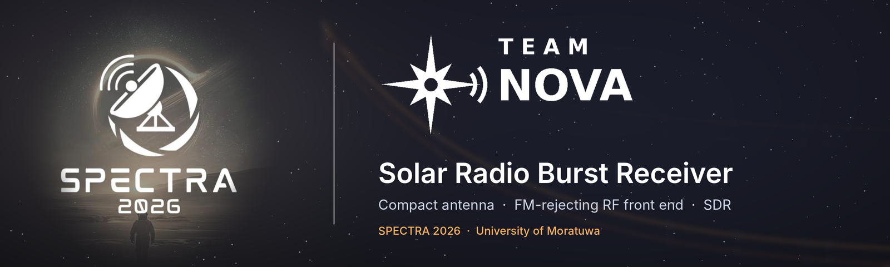

  

# NOVA Solar Radio Receiver

**Team NOVA · University of Moratuwa · SPECTRA 2026 RF Circuit & Antenna Design Competition**

A compact, low-cost receiver that listens to the Sun and catches its radio bursts, giving an early warning of space weather.

---

## The problem

The Sun is not as calm as it looks. Every so often it releases huge bursts of energy: **solar flares** and **coronal mass ejections (CMEs)**, enormous clouds of charged particles thrown out into space. When one of these heads towards Earth, it can cause a **geomagnetic storm**.

These storms affect technology we rely on every day:

- **Power grids**: in 1989 a solar storm blacked out the entire province of Québec, Canada, for nine hours.
- **Satellites**: in 2022 a minor storm caused 38 newly launched Starlink satellites to fall back to Earth.
- **GPS and navigation**: in 2024 a storm made GPS-guided farm machinery in the US wander off course in the middle of planting season.
- **Radio and radar**: in 2015 a solar radio burst disrupted air traffic control radar in Sweden, and flights had to be held.

Countries like Sri Lanka depend on GPS, satellite services and HF radio, used by fisheries, aviation and disaster management. All of these can be disrupted.

## The warning sign

Before a CME's shock wave reaches Earth, it often gives itself away. As it pushes out through the Sun's atmosphere, it produces a **radio burst**, a signal that sweeps down in frequency over a few minutes.

These radio bursts reach Earth at the speed of light, while the CME itself takes **one to three days** to arrive. If we catch the burst, we get time to prepare. Power grid operators can protect their networks, satellite operators can put spacecraft into safe mode, and airlines and navigation users can plan around the disruption.

## Why more stations are needed

These bursts are watched by a worldwide network of radio stations called **e-CALLISTO**, but coverage on the ground is patchy. Sri Lanka has only one station. Two things keep more stations from being set up:

1. The antennas normally used are several metres long, which makes them expensive and hard to install.
2. Cheap radio receivers get overwhelmed by nearby FM radio stations, which broadcast right next to the frequencies we want to listen to.

## What we are building

Our goal is a solar radio station that is **small, low-cost and simple enough for universities, schools and radio amateurs to build themselves**.

It has three parts:

- **A compact antenna.** It covers the frequencies where these bursts appear, but fits within one metre in every direction, so it can sit on a rooftop or balcony. It is built from aluminium tubes and plastic parts that are available locally.
- **A small RF circuit board.** It blocks the strong FM radio signals and boosts the faint signals from the Sun, so that a cheap radio can still hear them clearly.
- **A low-cost software-defined radio and software.** Together they turn the signal into a picture of the Sun's activity over time, and pick out the bursts.

With several identical stations in different places, detections can be checked against each other, and the data can be shared openly for research.

## About SPECTRA

**SPECTRA 2026** is the RF Circuit & Antenna Design Competition organised by the IEEE MTT-S Student Branch Chapter of the University of Moratuwa. This project is Team NOVA's entry, covering both the antenna and the RF circuit design challenges.

## Team NOVA

University of Moratuwa, Sri Lanka
